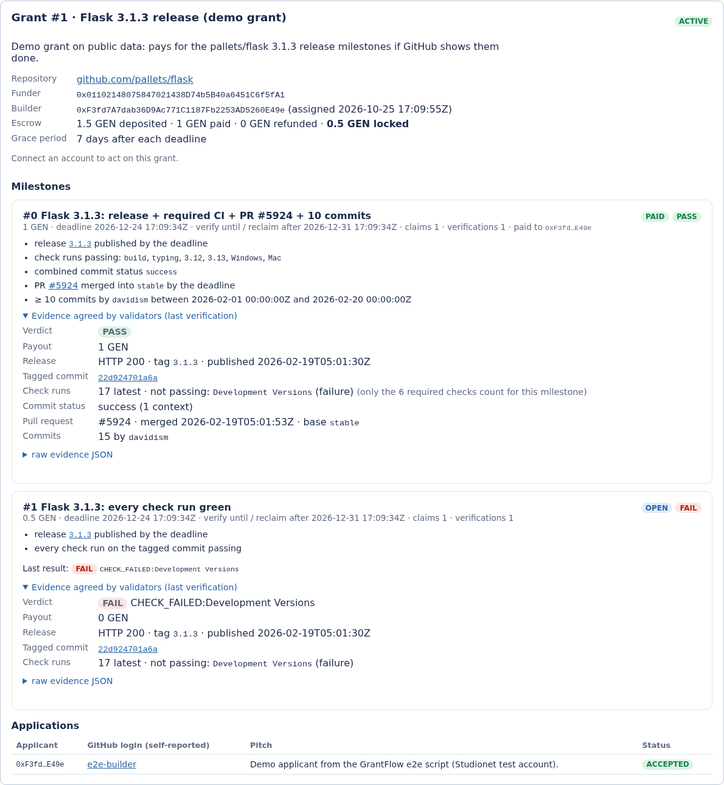

# GrantFlow: GitHub-verified milestone grants on GenLayer

GrantFlow is a web dApp plus a GenLayer Intelligent Contract for **milestone grants on public GitHub
repositories**. Funders post grants and lock the full amount in the contract. Builders apply, the funder assigns
one, and each milestone pays out when **GenLayer validators each read the GitHub REST API and agree** that the
milestone's criteria are met: a release tag published by the deadline, CI check runs and/or commit status passing,
a pull request merged into a given branch, or a minimum number of commits by a GitHub login. If a milestone is not
met by its deadline plus a grace period, the funder can take that milestone's GEN back.

> **Status: working prototype on GenLayer Studionet** (test GEN, no real value).
> Contract `0x72eEF6Ea426dCaBcD15F0A7B8864900cc0480940`; see [docs/LIVE_RUN.md](docs/LIVE_RUN.md) for every
> transaction of the live run (2 PASS and 1 FAIL verification on `pallets/flask` and `psf/requests`, all finalized).



## The trust problem

Open-source grants and bounties are usually paid by hand: a program manager checks whether the work shipped and then
sends money. The builder has to trust that the funder will pay; the funder has to check every milestone. Escrow
services move the trust to whoever operates the escrow or the oracle that reports "done".

Many milestones can be stated as public, checkable GitHub facts ("release `v1.2.0` is published by 1 December with
green CI", "PR #42 is merged into `main`"). GrantFlow locks the funds on-chain and lets **any** account trigger a
check that GenLayer validators perform independently against `api.github.com`. Payment follows from the agreed
evidence. Once a builder is assigned, the funder cannot cancel the grant, and a claimed milestone can be verified by
any account until its deadline plus grace period. A milestone is paid only when the validators agree that its
criteria are met.

## How GenLayer is central

The app has no backend. The browser talks only to the contract through `genlayer-js`.

| Step | Contract method | What validators do |
|---|---|---|
| **Verify a milestone** | `verify_milestone(grant_id, index)` | The leader fetches the release, the tagged commit, its check runs and/or combined status, the PR and the commit list from the public GitHub REST API and builds a 35-field evidence record. Every validator fetches the same URLs itself and agrees only if all 35 fields are identical to its own and the verdict follows from them. After consensus the contract re-checks the evidence against the stored criteria, then pays (PASS), re-opens the milestone (FAIL) or does nothing (DEFER). |

No LLM is used: GitHub facts are discrete (SHAs, names, conclusions, timestamps, counts), so the validator check
is an exact comparison of derived fields. Details: [CONSENSUS.md](CONSENSUS.md).

## What is new compared with my accepted contract

GrantFlow builds on my accepted Intelligent Contract **MilestoneGrant** (one funder, one grantee, one repository per
grant; Studionet `0x8cD1213d653E5fADADa3B79feBb06fbbF4033211`). The GitHub evidence and verdict code is **reused
unchanged**: the block between the `REUSED BEGIN` / `REUSED END` markers in `contracts/grantflow.py` is
byte-identical to lines 49-521 of `milestone_grant.py` (sha256 checked in `tests/direct/test_reuse.py`;
`python tools/check_reuse.py path/to/milestone_grant.py` compares the files directly). New in GrantFlow:

* **An open grant board for many funders.** Any account can post a grant (title, description, repository, 1-20
  milestones with their own amounts, deadlines and criteria, grace period). Grants are isolated from each other.
* **Builder applications and assignment.** A grant can be posted open for applications. Builders apply with a
  GitHub login (self-reported, shown to the funder, not verified on-chain) and a short pitch; the funder assigns one
  applicant, and the other pending applications are closed. A funder can also name the builder when posting.
* **Rules that protect the builder after assignment.** The funder can cancel a grant (refunding every open
  milestone) **only while no builder is assigned**. After assignment, unpaid milestones can only be reclaimed after
  their deadline plus grace. The builder can resign while no milestone is claimed; the grant then re-opens and
  later payouts go to the next assigned builder (each payment is recorded as `paid_to`).
* **Read views for a UI:** `get_stats` (counts by status, escrow totals, PASS / FAIL / DEFER counters),
  `list_grants` and `list_grants_by_status` (paginated, newest first), per-funder and per-builder grant lists,
  applications per grant and per builder, and the GitHub URLs a milestone is checked against.
* **The web dApp** (`frontend/`): Grants / Funder / Builder / Settings tabs, burner account or MetaMask, Studio
  faucet, a transaction log that shows every write from signature to consensus result, and the evidence each
  verification recorded.

## Architecture

```
 Browser (static Vite app, frontend/)                     GenLayer Studionet
 ┌────────────────────────────────────┐   genlayer-js   ┌───────────────────────────────────────┐
 │ Grants   · get_stats, list_grants, │ ──────────────► │ GrantFlow (contracts/grantflow.py)    │
 │            get_grant, verify ──────┼─ write ───────► │  grants ─ milestones ─ applications   │
 │ Funder   · create_grant (+deposit),│                 │  (TreeMaps + per-address indexes)     │
 │            assign, cancel, reclaim │                 │                                       │
 │ Builder  · apply, claim, resign    │ ◄── views ───── │  verify_milestone ── run_nondet ──┐   │
 │ Settings · contract, account       │                 └───────────────────────────────────┼───┘
 └────────────────────────────────────┘                   leader + each validator fetch:    │
   account: burner key (localStorage)                     api.github.com (public, no auth) ◄┘
   or MetaMask (window.ethereum)
```

Grant and milestone lifecycle:

```
 create_grant ─► OPEN ──apply/assign──► ACTIVE ──(all milestones settled)──► CLOSED
                  │                       │  ▲
                  │ cancel_grant          │  └── resign (no milestone CLAIMED) → back to OPEN
                  ▼                       │
               CANCELLED (open milestones refunded)

 milestone: OPEN ─claim─► CLAIMED ─verify─┬─ PASS  ─► PAID (amount to the assigned builder, once)
                ▲                         ├─ FAIL  ─► OPEN (fix and claim again before the deadline)
                └─────────────────────────┘  DEFER ─► stays CLAIMED (GitHub error / 404 / rate limit / pending CI)
 OPEN or CLAIMED after deadline + grace ─reclaim─► RECLAIMED (amount back to the funder)
```

All money values are integers (wei); times are unix seconds (UTC).

## Contract API (`contracts/grantflow.py`)

| Method | Type | Who | Notes |
|---|---|---|---|
| `create_grant(title, description, owner, repo, grace_days, milestones, builder)` | write, payable | anyone | `msg.value` must equal the sum of milestone amounts. `builder` = `""` opens the grant for applications. Returns the grant id. |
| `apply(grant_id, github_login, pitch)` | write | anyone but the funder | OPEN grants only; one pending application per address; max 50 per grant. |
| `withdraw_application(grant_id)` | write | applicant | |
| `assign_builder(grant_id, builder)` | write | funder | Builder must have a pending application. |
| `cancel_grant(grant_id)` | write | funder | Only while no builder is assigned; refunds every OPEN milestone. |
| `resign(grant_id)` | write | assigned builder | Only while no milestone is CLAIMED; grant re-opens. |
| `claim_milestone(grant_id, index)` | write | assigned builder | OPEN milestone, before its deadline. |
| `verify_milestone(grant_id, index)` | write, **non-deterministic** | anyone | CLAIMED milestone, until deadline + grace. |
| `reclaim_milestone(grant_id, index)` | write | funder | OPEN or CLAIMED milestone after deadline + grace. |
| `get_stats()`, `get_grant(id)`, `get_milestone(id, i)`, `list_grants(offset, limit)`, `list_grants_by_status(status, offset, limit)` | view | | |
| `get_funder_grants(addr)`, `get_builder_grants(addr)`, `get_grant_applications(id)`, `get_builder_applications(addr)`, `get_static_urls(id, i)` | view | | |

Milestone fields (as in MilestoneGrant, plus `label`): `amount`, `deadline`, `tag`, optional `not_before`,
`checks` (`none` / `check_runs` / `status` / `both`), `required_checks`, `pr_number` + `pr_base`,
`commit_author` + `min_commits` + `commits_since` + `commits_until`.

## Deployed contract

| | |
|---|---|
| Network | GenLayer Studionet (`https://studio.genlayer.com/api`) |
| Address | `0x72eEF6Ea426dCaBcD15F0A7B8864900cc0480940` ([explorer](https://explorer-studio.genlayer.com/address/0x72eEF6Ea426dCaBcD15F0A7B8864900cc0480940)) |
| Deploy tx | `0xcd5ee6eade7e2967b6f705e8b50f48ff4bc5b41cd356026a88c19f4019791e04` (FINALIZED, 3 agree, 2 idle) |
| Source sha256 | `8366ecc6c5c341a7a50da14974403b0736d4eab809980bc762637e0f065d0755` (`npm run verify-code` compares it with the on-chain code: MATCH) |
| SDK | `py-genlayer:1jb45aa8…` (GenVM v0.2.x) |

## Run it

### Contract tests (direct mode, no Studio needed)

```bash
python3 -m pip install -r requirements.txt
genvm-lint check contracts/grantflow.py       # lint + SDK validation
genvm-lint typecheck contracts/grantflow.py   # pyright with the GenLayer SDK
pytest tests/direct -q
```

The first run downloads the GenVM v0.2.16 SDK (`tests/direct/conftest.py` pins it). GitHub responses are real API
captures; see [tests/direct/fixtures/README.md](tests/direct/fixtures/README.md).

Result on 2026-10-25: **133 passed**. `genvm-lint check`: lint passed (3 checks), validation passed (19 methods:
10 view, 9 write). `genvm-lint typecheck`: 0 errors, 0 warnings (4 informational notes on `.get()` results, the same
as in MilestoneGrant).

| File | Tests | Covers |
|---|---|---|
| `test_verify.py` | 39 | PASS / FAIL / DEFER on real `pallets/flask` captures, every criterion, error mapping, retries, double payment (ported from MilestoneGrant) |
| `test_validator.py` | 36 | validator equivalence: agreement, different GitHub data, tampering with each of the 35 evidence keys (ported) |
| `test_registry.py` | 31 | posting grants from several funders, exact deposit, field and milestone validation, paginated and filtered views, unknown ids |
| `test_applications.py` | 10 | apply rules and limit, assign, withdraw, resign, re-assign with payouts to the right builder |
| `test_lifecycle.py` | 10 | cancel before assignment only, reclaim timing, verify window, 3-milestone schedule (PASS / FAIL / reclaim), DEFER, isolation between funders, `grant_id` binding |
| `test_second_repo.py` | 4 | real `psf/requests` captures: check-runs PASS, `STATUS_NONE` FAIL, validator rejects evidence from another repo |
| `test_reuse.py` | 3 | the reused block is byte-identical to MilestoneGrant (sha256) and not redefined |

### Frontend

```bash
cd frontend
npm ci
npm run dev        # http://localhost:5173
npm run build      # static files in frontend/dist
```

The default contract address is in `frontend/src/config.js`. You can override it at build time with
`VITE_GRANTFLOW_ADDRESS=0x… npm run build`, or in the app under **Settings**.

**Vercel:** import the repository, set **Root Directory** to `frontend` (framework Vite, build `npm run build`,
output `dist`; `frontend/vercel.json` sets the same). No environment variables are required.

### Live demo walkthrough

1. Open the app. Click **Use burner account**, then **+10 test GEN** (Studio faucet). The burner key lives in your
   browser's localStorage; use it for Studionet test GEN only. **Connect MetaMask** also works: the app asks the
   wallet to add or switch to GenLayer Studionet (no Snap needed).
2. **Funder** tab: click **Fill example (pallets/flask 3.1.3)** or enter your own public repository, milestones and
   amounts, then **Post grant**. The deposit equals the milestone total.
3. **Builder** tab (use a second browser profile or account): open a grant from *Open grants* and **Apply**.
4. As the funder, open the grant and **Assign** the applicant.
5. As the builder, **Claim milestone** once the work is visible on GitHub.
6. Anyone: **Verify on GitHub**. After validator consensus (about 15 s to 2 min on Studionet), the milestone shows
   PASS, FAIL or DEFER, and the grant page shows the evidence the validators agreed on.

### Scripts (Node, same client library as the UI)

```bash
cd frontend
npm run deploy:contract -- --fund-gen 100   # deploy contracts/grantflow.py (throwaway key, Studio faucet)
node scripts/e2e.mjs faucet|grant1|apply <g>|assign <g>|claim <g> <i>|verify <g> <i>|wait <tx>|grant-open|grant-cancel|balances
npm run read                                # print live contract state (no key)
npm run verify-code                         # on-chain code == contracts/grantflow.py ?
```

Keys are read from `GRANTFLOW_<ROLE>_KEY`, or from `../.studionet-grantflow-<role>.key` **outside** the repository
(created on first use). `.gitignore` excludes `*.key` and `.env*`. No key is committed.
`tools/browser_check.py` drives the built frontend in headless Chromium (Playwright) against the live contract; it
was used for section B of the live run.

## Limitations

* **Prototype on Studionet.** Test GEN only.
* **Only public GitHub facts.** Criteria are what the unauthenticated GitHub REST API shows for a public
  repository. They show that a release, CI result, merge or commit count exists, not the quality of the work.
  A funder should write criteria that match what they actually want to pay for.
* **GitHub data can change.** Check runs can be re-run, releases edited or deleted. A verification uses the data
  at the time it runs; a change in the middle of a round makes validators disagree and the round is retried.
* **GitHub rate limits.** Unauthenticated requests are limited per IP (60 per hour). A rate-limited fetch gives
  DEFER (no money moves) and the verification can be retried later.
* **Self-reported GitHub logins.** The login in an application is not verified on-chain. A milestone's
  `commit_author` criterion is set by the funder and is not tied to the builder's address.
* **No partial payments or disputes beyond re-verification.** A milestone pays its full amount or nothing. FAIL can
  be fixed and re-claimed before the deadline; there is no arbitration step.
* **Views scan in memory.** `get_stats` and `list_grants_by_status` iterate over all grants; fine at demo scale,
  an index per status would be needed for a large board.
* **MetaMask path not tested end to end here** (headless browser, no wallet). The burner path is the tested one.
* **SDK version.** Pinned to `py-genlayer:1jb45aa8…` (GenVM v0.2.x). Moving to v0.3 needs the documented renames
  (`run_nondet` → `run_nondet_default`, …).

## Roadmap / future milestones

1. **Testnet deployment with a first real grant cycle.** Migrate to the GenVM v0.3 SDK, deploy to the GenLayer
   public testnet, host the frontend, and run a full grant cycle on a real repository (post, apply, assign, claim,
   verify, plus a reclaim after a missed deadline), recorded with transaction hashes.
2. **Verified builder identity.** Link a builder's address to a GitHub login with a gist or commit signed by that
   address and checked by validators, and let milestones use "commits by the assigned builder" as a criterion.
3. **Shared funding and partial payouts.** Several funders co-funding one grant (pro-rata refunds), top-ups, and
   milestones that pay in tranches (e.g. per merged PR in a list).

## Repository layout

```
contracts/grantflow.py            the Intelligent Contract
tests/direct/                     direct-mode tests + real GitHub API fixtures (133 tests)
CONSENSUS.md                      verification consensus design
frontend/                         Vite web app (vanilla JS + genlayer-js), vercel.json
  src/lib/grantflow.js            client library shared by UI and scripts
  src/main.js                     UI
  scripts/                        deploy, e2e, read, verify-code (Node)
docs/LIVE_RUN.md                  live Studionet run with tx hashes
docs/screenshots/                 screenshots from the headless-browser run
tools/browser_check.py            headless Chromium check of the built app
tools/check_reuse.py              compare the reused block with milestone_grant.py
.github/workflows/ci.yml          CI (lint + tests + build)
```

License: MIT
